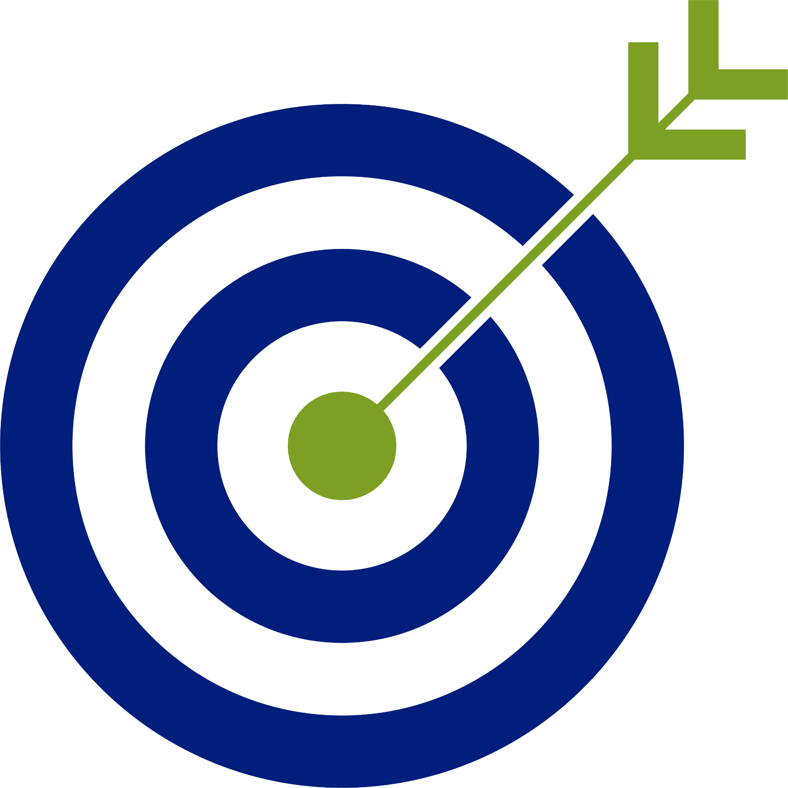
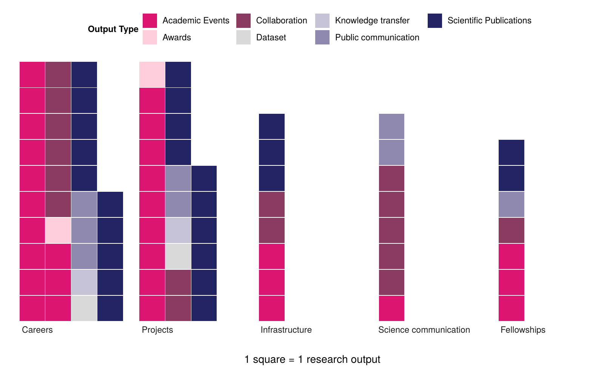
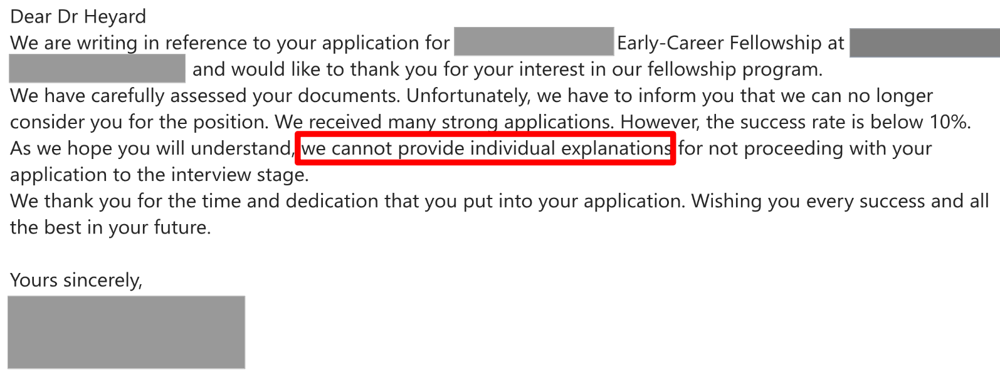
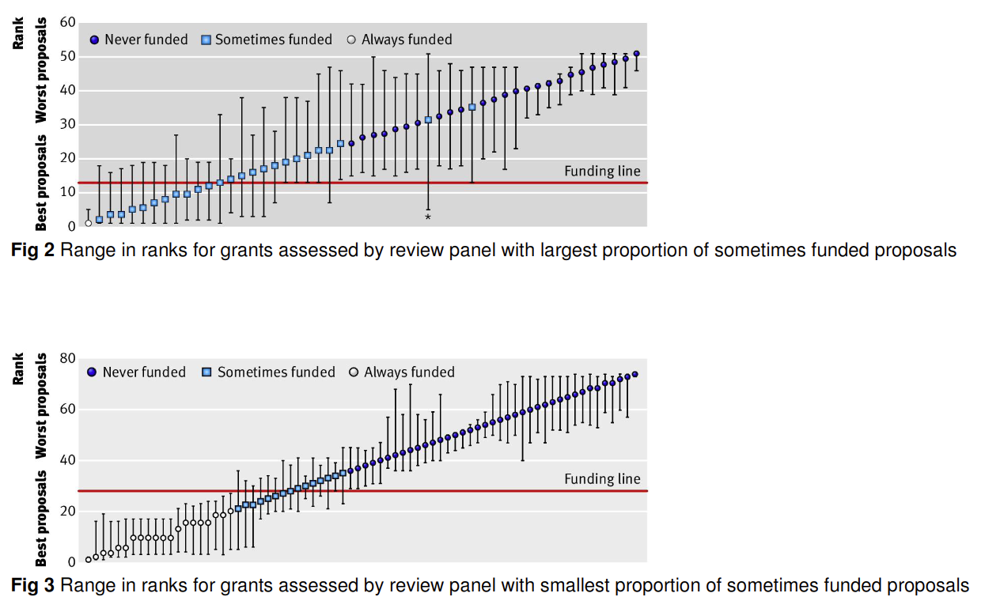
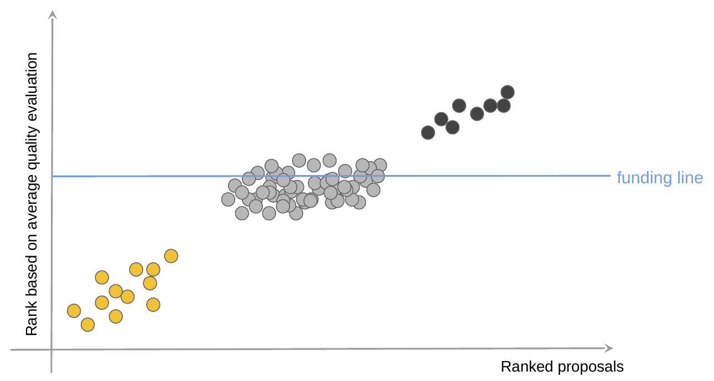
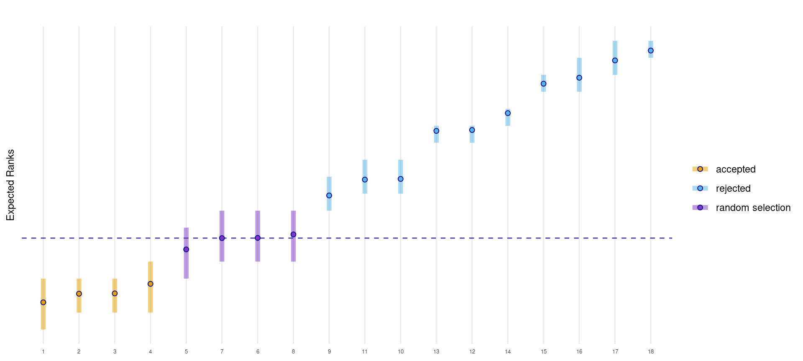
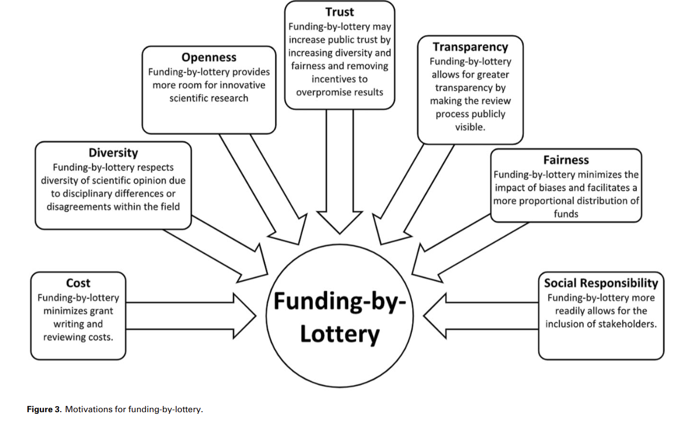
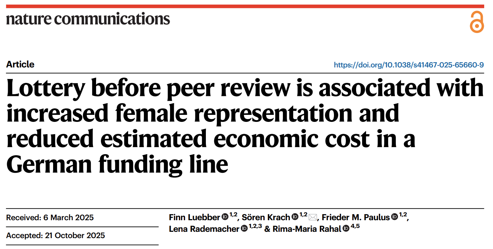
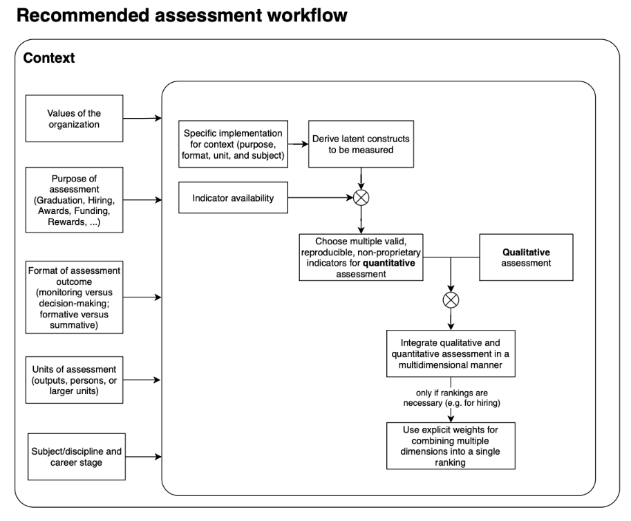

## {.no-logo}

{.title-logo-uzh}
{.title-logo-crs}
{.title-target}

<h1 class="title-main">Studying the Research System</h1>
 

Metaresearch, Incentives, and Research Assessment Reform

<b>Rachel Heyard</b> · Center for Reproducible Science and Research Synthesis (CRS), University of Zurich

 

Ringvorlesung <i>Fake Science: Isolated Cases or a Systemic Problem?</i> · 10 November 2026

## Some personal [disclosures]{.g}

- Senior researcher at CRS, UZH
- Open and reproducible science enthusiast 

 

Relevant experience, for the purpose of this talk

- Worked in the data team of the [Swiss National Science Foundation]{.g} (SNSF)
- Steering committee member of [CoARA]{.g} working group on "Responsible Metrics and Indicators"
- Lead the [SwissRN]{.g} working group on "Research Assessment and Incentives"

<!-- dora-logo.png contains the CoARA logo (filenames are swapped) -->

## Central premise of today: [it's the incentives]{.g}

 

<b>Incentive structure</b> Strong focus on papers, impact factor, grants, ...

→

<b>Behaviour</b> Questionable research practices 

→

<b>Outcome</b> Unreliable &amp; fake science

 

::: notes
This is the premise of the whole lecture series, and of a lot of the integrity literature: individual misconduct is a symptom; the cause is the incentive structure.
Today: (1) What does that structure actually reward? (2) Why is it so hard to get out of? (3) What can we design differently — and where do current reforms come from?
:::

##  Metaresearch   [Studying the research system]{.g} with the tools of science

::: {.fragment fragment-index=1}
*Five areas of meta-research*:
:::

**Methods** -- how we do research

**Reporting** -- how we communicate it

**Reproducibility** -- how we verify it

**Evaluation** -- how we assess it

**Incentives** -- how we reward it

::: {.ref}
Ioannidis, Fanelli, Dunne & Goodman (2015) PLoS Biol — [10.1371/journal.pbio.1002264](https://doi.org/10.1371/journal.pbio.1002264)
:::

::: notes
Incentives are literally one of the five pillars of the field. Evaluation and incentives are the two that funders and institutions control directly.
:::

# What does the system reward? {.section-slide background-color="#EFEFEF"}

[Part 1]{.kicker}

## Institutions

 **[Promotion criteria]{.g} **

. . . 

Review of promotion & tenure guidelines of 92 faculties of biomedical science. 

[What did the guidelines mention as criteria?]{.g}

 

. . .

95%

peer-reviewed publications

67%

grant funding

28%

journal impact factor

1%

data sharing

0%

open access · study registration · reporting guidelines

3%

alternative metrics for sharing research (e.g. social media)

[*Note:* paper published in 2020; the paper does not say *when* the guidelines were retrieved.]{.small .muted}

::: {.ref}
Rice, Raffoul, Ioannidis & Moher (2020) BMJ — [10.1136/bmj.m2081](https://doi.org/10.1136/bmj.m2081). See also McKiernan et al. (2019) eLife on the JIF in promotion documents.
:::

::: notes
This is the formal incentive structure, written down. Almost every institution counts peer-reviewed publications; many require a minimum number per year. Data sharing, registration, reporting guidelines: essentially absent.
[Optional: a Swiss/UZH example of promotion criteria.]
:::

<!-- ## Institutions: the [impact factor]{.g} in promotion documents -->

<!-- 
Review, promotion & tenure (RPT) documents, representative sample of US & Canadian universities
 -->

<!-- :::: {.columns} -->
<!-- ::: {.column width="34%"} -->
<!-- **Mention the JIF** -->

<!-- 
 -->
<!-- 

40%

of research-intensive institutions

 -->
<!-- 

18%

of master's institutions

 -->
<!-- 
 -->
<!-- ::: -->
<!-- ::: {.column width="66%"} -->
<!-- **Of those that mention it…** -->

<!-- 
 -->
<!-- 

87%

support its use

 -->
<!-- 

13%

express caution

 -->
<!-- 

0%

criticise or prohibit it

 -->
<!-- 
 -->

<!-- 
<b>…and link it to</b>
 -->

<!-- 
 -->
<!-- 

63%

quality

 -->
<!-- 

40%

impact, importance, significance

 -->
<!-- 

20%

prestige, reputation, status

 -->
<!-- 
 -->
<!-- ::: -->
<!-- :::: -->

<!-- 
The JIF is encouraged — and read as a measure of quality — especially at research-intensive universities.
 -->

<!-- ::: {.ref} -->
<!-- McKiernan, Schimanski, Muñoz Nieves, Matthias, Niles & Alperin (2019) eLife — [10.7554/eLife.47338](https://doi.org/10.7554/eLife.47338) -->
<!-- ::: -->

<!-- ::: notes -->
<!-- Complements Rice et al.: not only are publications counted, the journal they appear in is taken as a proxy for quality, and almost nobody warns against it. Contrast with the evidence that the JIF does not predict article quality (backup slide). -->
<!-- ::: -->

## Funders

What they **[say]{.g} _vs._** what researchers are asked to **[report]{.g}**

:::: {.columns}
::: {.column width="40%"}
 

<b>What the funder says it values</b>Open science, reproducibility, data sharing as a safeguard against misconduct.
SNSF expects data underlying publications to be shared.

↓

<b>What the reporting system asks for</b>An output list built around publications, filled in ~6 months after the project ends. Software, teaching material, theses, preprints: hard or impossible to report.

↓

<b>What we see reported</b>≈ 10 publications per dataset (Projects, 2022). Only 20–33% of Projects grants report any dataset.

:::
::: {.column width="60%"}
::: {.fragment fragment-index=3}
{width="92%"}

Average number of outputs per SNSF grant completed in 2022, by scheme and output type.

:::
:::
::::

::: {.ref}
Heyard, Furrer, Held, Würbel, Vergauwe & Ochsner (2024) SwissRN policy brief — [osf.io/zdnpm](https://osf.io/zdnpm/files/vgs4b) · data: [data.snf.ch](https://data.snf.ch/datasets)
:::

## Funders

The **[high stakes]{.g}** of the **funding game**

 

<!-- the previous is especially problematic because of the "funding game" -->
{.shadow width="100%"}

## Funders

The **[high costs]{.g}** of the **funding game**

. . .

:::: {.columns}
::: {.column width="50%"}

 

Observational / survey study on 3,727 proposals to one funding round (March 2021) of the National Health and Medical Research Council of Australia.
:::

::: {.column width="50%"}
**Results **

34

working days per proposal (38 new · 28 resubmitted)

550

researcher-years for one funding round

AU$ 66 M

in salary costs

:::
::::

::: {.ref}
Herbert, Barnett, Clarke & Graves (2013) BMJ Open — [10.1136/bmjopen-2013-002800](https://doi.org/10.1136/bmjopen-2013-002800)
:::

::: notes
Herbert: new proposal 38 working days, resubmission 28, average 34. 550 working years for 3,727 proposals, AU$66 million in salary costs.
:::

## Funders

A **[partly random]{.g}** **funding game**

:::: {.columns}
::: {.column width="70%"}
{width="100%"}
:::
::: {.column width="30%"}

- 90% confidence intervals for proposal ranks after evaluation 

- Some proposals **always** funded, some **never**; and a large group **sometimes funded**
- At the funding line, the decision is partly [**chance**]{.g}
:::
::::

::: {.ref}
Graves, Barnett & Clarke (2011) BMJ — [10.1136/bmj.d4797](https://doi.org/10.1136/bmj.d4797) 
:::

## A circle that is [hard to get out of]{.g}
 
 

<b>Institutions &amp; funders</b>count papers, grants, JIF

→

<b>Researchers believe</b>only papers count

↑

&nbsp;

↓

<b>The bar moves up</b>longer CVs become the norm for "competitive"

←

<b>Researchers publish</b>more, faster, "positive" -- questionable research practices

<!-- ::: {.column width="42%"} -->
<!-- ::: {.fragment fragment-index=6} -->
<!-- **Why it is hard to leave** -->

<!-- - **First-mover problem**: the researcher, university or funder who stops counting papers alone pays the price -->
<!-- - Evaluators need **cheap signals at scale** — counting is cheap -->
<!-- - Today's evaluators were **selected by the old currency** -->
<!-- - **Perception lags** behind policy change -->
<!-- ::: -->
<!-- ::: -->

::: notes
Key slide of part 1. Everyone in the loop behaves rationally given what they believe the others reward. Nobody can exit alone. That's why individual appeals ("just do good science") don't work, and why coordinated action (later: DORA, CoARA) matters.
:::

# Breaking the circle by design {.section-slide background-color="#EFEFEF"}

[Part 2 — how metaresearch can inform solutions]{.kicker}

## Incentives are designed -- [one call at a time]{.g}

. . .

<b>Funder degrees of freedom</b> influence what gets rewarded, how, and who gets funded.

 

. . .

<b>Objectives & eligibility</b>who can apply, career stage, topic, ...

<b>Application format</b>CV type, DMP, project plan, ...

<b>Evaluation criteria</b>what counts: pubs, rigor, openness, ...

<b>Reviewers & panels</b>who, how many, composition, training

<b>Scoring & decision rule</b>scales, aggregation, ranking, lottery

<b>Checks & reporting</b>integrity checks, output lists, monitoring

Each choice signals what "good research" is -- and each is a lever against bad & fake science.

. . . 

<!-- I would therefore argue that  -->

Incentives can be redesigned.

## Mapping funders' decision-making processes {.dense}

<b>Gabrielle Chan</b> CRS, University of Zurich

<b>Thomas Feliciani</b> University of Coimbra

. . .

**Decision-making processes for research funding -- a review**

- Funders choose call objectives, eligibility, criteria, panel set-up.. 

- _But_ there is **no comprehensive map** of these choices & no evidence-based tools to choose 

. . . 

- **Aim:** an open, expandable, scalable mapping of the design aspects of funding calls

 

. . .

--> Halfway in the project: Funders are not very transparent about their design choices.

::: {.ref}
Heyard, Chan & Feliciani (2026) Zenodo — [10.5281/zenodo.19133106](https://doi.org/10.5281/zenodo.19133106) 
:::

## One choice / lever: Final funding [decision]{.g}

. . . 

{width="75%"}

Average-based ranking often not very useful to differentiate proposals in the middle.

## One choice / lever: Funding [lotteries]{.g}
{width="40%"}

<!-- At SNSF: Bayesian ranking → fund the clearly strong, reject the clearly weak, [draw lots among the indistinguishable]{.g} -->

::: {.ref}
Heyard, Ott, Salanti & Egger (2022) Stat Public Policy — [10.1080/2330443X.2022.2086190](https://doi.org/10.1080/2330443X.2022.2086190) · R package: [ERforResearch](https://github.com/snsf-data/ERforResearch)
:::

::: notes
Keynote slides 29–30. Link to the circle: if the margin is a lottery anyway (Graves), making it explicit removes the illusion that one more paper buys the decision, reduces bias, and is transparent. A direct consequence of research on research.
:::

## Funding lotteries: [why]{.g}?

. . .

 

{width="60%"}

::: {.ref}
Shaw (2022) Res Eval — [10.1093/reseval/rvac022](https://doi.org/10.1093/reseval/rvac022)
:::

## Funding lotteries: [what do they do]{.g}?

 

:::: {.columns}
::: {.column width="55%"}
 
{.shadow width="100%"}

:::
::: {.column width="45%"}
 

First evidence:

- Lottery **before** peer review
- Associated with **more women** among those funded,
- And a **lower estimated economic cost**

::: {.fragment}

But what does winning -- or losing -- the draw do to a career?

:::
:::
::::

::: {.ref}
Lübber et al. (2025) Nat Commun --  [10.1038/s41467-025-65660-9](https://doi.org/10.1038/s41467-025-65660-9)
:::

::: notes
Keynote slides 35–36. Still very little causal evidence on what lotteries do to the people who win or lose the draw → our study (next slide).
:::

## Lottery funding & academic careers -- a randomized natural experiment {.dense}

<b>Hillary Wnfried Ramirez</b> CRS, University of Zurich

<b>Ben Jann</b> University of Bern

<b>Dominic Rohner</b> University of Lausanne

<b>Leonhard Held</b> CRS, University of Zurich

<b>Matthias Egger</b> CRS, University of Zurich

 

. . . 

:::: {.columns}
::: {.column width="52%"}
- SNSF modified lottery 2019--2023:
  - 267 Project Funding · 230 Fellowships
- Random draw among equally rated proposals → **causal** effect of funding
- Primary outcomes: field-normalised citations, publications, **career retention**
- Stage 1 **Registered Report** submitted
:::
::: {.column width="48%"}

Proposals evaluated

↓

Clearly fund

<b>Indistinguishable</b>  lottery (n = 497)

Clearly reject

↓

Won the draw <b>funded</b>

vs

Lost the draw <b>not funded</b>

↓

Compare: citations · output · career retention

:::
::::

::: {.ref}
Heyard, Ramirez, Jann, Rohner, Held & Egger (2026) preprint — [10.5281/zenodo.23189200](https://doi.org/10.5281/zenodo.23189200)
:::

::: notes
Why this matters for the incentive debate: it tells us how much is really at stake at the margin — the causal "value" of a grant (cf. Bol et al.: >2× later funding). If the effect is large, near-random margins are a fairness problem; if small, the perceived stakes exceed the real ones — and the circle is partly running on beliefs.
Practising what we preach: Registered Report, SPIRIT checklist, pre-specified analysis, opt-out for applicants.
:::

## Another possible choice or lever

**[Integrity checks at the gate]{.g}**

. . . 

 

Most of what we heard in this series is **after the fact**: image forensics, data sleuthing, retractions.

<!--   -->

. . .

**What if funders could spot red flags *before* the money flows?**
<!--   -->

. . .

<b>Plan</b> protocol · SAP

→

Fund

→

Conduct

→

Publish

→

<b>Detect</b> &amp; retract

↑ INSPECT (**I**dentifying **N**on-obvious **S**ignals in **P**rotocols for **E**arly **C**redibility **T**hreats)

most forensic work today ↑

 

<b>Alfonso Rojas Mora</b> 

<b>Hillary Wnfried Ramirez</b> 

<b>Peter Degen</b> 

<b>Ulrike Held</b> 

<b>Leonhard Held</b> 

## INSPECT -- early warning signs in clinical trial protocols {.dense}

 

QRPs => whole spectrum from honest error to fraud

. . .

- **Aim**: understand which QRPs could, in theory, be detected in planning documents (and how)
- **Rapid review** and **Expert consultation**  

. . .

--> We identified **67** QRPs for which red flags could potentially be detected in trial protocols  

. . .

Examples:  
  - [Low author-to-study size ratio]{.g} (related to plausibility / feasibility)    
  - [Compromised study team integrity]{.g}  
  - [Outcome switching]{.g}  
 

. . .

<!--    -->

--> **Next**: feasibility study to understand applicability of trustworthiness checks during protocol review

Examples:  
- [Do other studies by the research team highlight causes for concern?]{.g}  
- [Are secondary outcomes numerous, unordered, or not distinguished from exploratory outcomes?]{.g}

::: {.ref}
[crsuzh.pages.uzh.ch/inspect](https://crsuzh.pages.uzh.ch/inspect/) · Rojas Mora, A., Wnfried Ramirez, H., Degen, P. M., Held, U., Held, L., & Heyard, R. (2026) [https://doi.org/10.31222/osf.io/d5hsu_v1](https://doi.org/10.31222/osf.io/d5hsu_v1)
:::

# Research assessment reform {.section-slide background-color="#EFEFEF"}

[Part 3 — where are we, and how did we get here?]{.kicker}

## A decade of [reform]{.g}

2012/13

2015

2019

2021

2022

2023 →

<b>DORA</b>drafted at meeting in San Francisco: stop using the JIF to assess individuals

<b>Leiden Manifesto</b>responsible use of metrics

<b>Hong Kong Principles</b>6th WCRI: reward integrity · NL: "Room for everyone's talent"

<b>UNESCO</b>Recommendation on Open Science

<b>CoARA</b>Agreement co-created by 350+ organisations from 40 countries; coalition launched 1.12.2022

<b>Since</b>national chapters, working groups, action plans

::: {.ref}
[sfdora.org](https://sfdora.org) · Hicks et al. (2015) Nature 520:429 · Wilsdon et al. (2015) *The Metric Tide* · Moher et al. (2020) PLoS Biol [10.1371/journal.pbio.3000737](https://doi.org/10.1371/journal.pbio.3000737) · [coara.eu](https://coara.eu) 
:::

## How did these reforms [come about]{.g}?

<b>1 · Evidence</b>Metaresearch showed the problems: JIF does not predict quality; reproducibility crisis; bias in peer review; random outcomes at the funding line

<b>2 · Communities</b>Researchers organised bottom-up: reproducibility networks (SwissRN), young academies, open science initiatives

<b>3 · Coalitions</b>Funders, universities and academies committing <i>together</i> -- the only way around the first-mover problem

## Responsible [metrics]{.g}?

 

::: {.fragment fragment-index=1}

"So which metrics <i>should</i> we use instead?"

:::

 

::: {.fragment fragment-index=2}

There are no responsible metrics.  Only responsible use of metrics.

:::

::: {.fragment fragment-index=3}

The same indicator can be informative in one assessment and harmful in another. It depends on what you want to know, about whom, and for which decision.

:::

::: notes
When people hear "responsible metrics", they ask for a list: which indicators are the good ones? But no indicator is responsible or irresponsible in itself. The question is how it is chosen and used. That's what the workflow on the next two slides is about. (CoARA working group on Responsible Metrics and Indicators.)
:::

## How metrics are usually used: [indicators first]{.g}

<b>Indicators are chosen based on availability</b>

→

It is unclear what latent construct should be measured. Validity unknown

→

Unidimensional ranking of candidates

<b>Because they're there</b>publication counts, impact factor, h-index, grant income: easy to download and count

<b>Measuring what?</b>quality? impact? productivity? prestige?

<b>One number</b>a single ranking of candidates, hiding every other dimension

::: {.fragment fragment-index=4}

The available metric decides what counts.

:::

 

<b>Felix Schönbrodt</b> LMU Munich

<b>Davide Crepaldi</b>  University of Pavia

<b>Katarzyna Nawrot</b>  University of Warsaw

::: {.ref}
[10.31222/osf.io/9cdns_v1](https://doi.org/10.31222/osf.io/9cdns_v1)
:::

## Responsible use: [start from the context]{.g} {.dense}

{.wf-fig}

::: {.ref}
[10.31222/osf.io/9cdns_v1](https://doi.org/10.31222/osf.io/9cdns_v1)
:::

::: notes
The recommended workflow. Indicator availability enters only after you have decided what you want to measure and why. Quantitative indicators support qualitative judgement — CoARA commitment 2: "Base research assessment primarily on qualitative evaluation for which peer review is central, supported by responsible use of quantitative indicators."
:::

## Reforms are interventions -- [evaluate them]{.g} in different contexts

 

. . .

Example: **open-data badges**

2.5% → 23%

<i>Psychological Science</i> after introducing badges (before–after)

≈4% vs ≈4%

<i>BMJ Open</i>, randomized trial of badges: no effect

 

Same intervention, different context, different design → different answer.
 

<!-- New criteria can be gamed too (narrative CVs reward good writers?) -->

::: {.ref}
Kidwell et al. (2016) PLoS Biol [10.1371/journal.pbio.1002456](https://doi.org/10.1371/journal.pbio.1002456) · Rowhani-Farid, Aldcroft & Barnett (2020) R Soc Open Sci [10.1098/rsos.191818](https://doi.org/10.1098/rsos.191818)
:::

::: notes
Reforms change the incentive structure — so they can have unintended consequences of their own (Goodhart applies to new indicators too). Experimentation instead of tradition; evaluation built in from the start.
:::

## Take-home

1. **The premise largely holds** -- promotion, funding and our own beliefs all reward publication counts etc

2. **It's complicated** -- no researcher, university or funder can leave it alone  

4. **Incentives are designed** --  funders and institutions have many degrees of freedom; map them, test them, and [redesign]{.g} those incentives  

5. **Reforms came from evidence, communities and coalitions** -- and they need evaluation, too  

## Thank you! {.no-logo}

:::: {.columns}
::: {.column width="55%"}
**Rachel Heyard** 
Center for Reproducible Science and Research Synthesis, UZH 
[rachel.heyard\@uzh.ch]{.small}

:::
::: {.column width="45%"}

{width="45%" style="margin-top:0.6em;"} {width="16%"}
:::
::::

